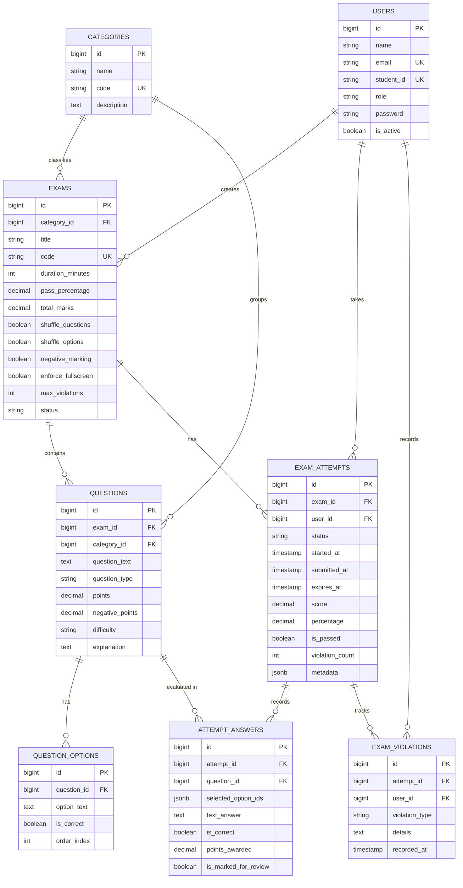

# 🎓 Computer-Assisted Test (CAT) System Web Application

[](#)
[](#)
[](#)
[](#)

A production-ready, high-concurrency, enterprise-grade **Computer-Assisted Test (CAT) / Computer-Based Test (CBT)** web application designed for academic institutions, certification bodies, and corporate recruitment centers. Built with **Laravel 13**, optimized for **PostgreSQL 18**, and rendered with an **offline-first Bootstrap 5.3 + Bootstrap Icons** UI that runs completely on internal local area networks without requiring internet access.

---

## 📑 Table of Contents

- [Architectural Overview](#-architectural-overview)
- [Key Features](#-key-features)
  - [1. Testing & Assessment Engine](#1-testing--assessment-engine)
  - [2. Anti-Cheat & Automated Proctoring](#2-anti-cheat--automated-proctoring)
  - [3. Live Proctor Supervision Center](#3-live-proctor-supervision-center)
  - [4. Bulk Data Import & Export System](#4-bulk-data-import--export-system)
  - [5. Assessment Psychometrics & Analytics](#5-assessment-psychometrics--analytics)
  - [6. 100% Offline Internal Network Architecture](#6-100-offline-internal-network-architecture)
- [Pre-Seeded Credentials & Accounts](#-pre-seeded-credentials--accounts)
- [Database Schema (PostgreSQL 18)](#-database-schema-postgresql-18)
- [Installation & Setup Guide](#-installation--setup-guide)
- [Bulk Import Specifications & Formats](#-bulk-import-specifications--formats)
- [Automated Scheduled Tasks](#-automated-scheduled-tasks)
- [Security & Audit Trail](#-security--audit-trail)

---

## 🏛 Architectural Overview

The CAT platform separates responsibilities into modular domain services:

```
├── app/
│   ├── Http/
│   │   ├── Controllers/
│   │   │   ├── Admin/         # Exam CRUD, Questions, Candidates, Bulk Import, Analytics, Audit Logs
│   │   │   ├── Candidate/     # Test Lobby, CAT Testing Engine, Scorecards, Review, History
│   │   │   ├── Proctor/       # Real-Time Live Candidate Monitor & Control
│   │   │   └── Auth/          # Dual identifier authentication (Email or Student ID)
│   │   └── Middleware/
│   │       └── RoleMiddleware.php # RBAC (Admin, Proctor, Candidate)
│   ├── Models/                # Eloquent models with PostgreSQL 18 JSONB casts
│   └── Services/
│       ├── ExamEngineService.php   # Session initialization, question randomization, autosave, violations
│       ├── ExamGradingService.php  # Multi-type question evaluator with negative marking
│       ├── BulkImportService.php   # Streaming CSV parser & validator for questions and users
│       └── AuditLogService.php     # Immutable administrative event logger
├── bootstrap/
│   ├── app.php                # Unified Laravel 13 router and middleware pipeline
│   └── providers.php          # Service provider registrations
├── config/
│   ├── database.php           # PostgreSQL 18 optimized connection configuration
│   └── cat.php                # Centralized CAT engine parameters
├── database/
│   ├── migrations/            # Clean PostgreSQL DDL migrations with JSONB and foreign cascades
│   ├── sample_data/           # Ready-to-import question bank & candidate CSV datasets
│   └── seeders/               # Production seeders for admin, proctors, exams, and questions
├── public/
│   ├── vendor/                # 100% Offline Local Assets (No CDN required)
│   │   ├── bootstrap/         # Bootstrap 5.3.3 CSS & JS bundle
│   │   ├── bootstrap-icons/   # Bootstrap Icons CSS & WOFF/WOFF2 font files
│   │   ├── chartjs/           # Chart.js 4.4.2 UMD standalone engine
│   │   └── sweetalert2/       # SweetAlert2 modal dialog library
│   ├── css/custom.css         # CAT testing theme, question palette & printable scorecards
│   └── js/exam-engine.js      # Client-side testing engine with timer, autosave & anti-cheat hooks
└── resources/views/           # Blade templates organized by role (admin, proctor, candidate, auth)
```

---

## 🚀 Key Features

### 1. Testing & Assessment Engine
- **Multi-Type Question Bank**:
  - `Single Choice` (standard multiple-choice with 1 correct answer).
  - `Multiple Choice` (multi-select questions with partial or full credit).
  - `True / False` (binary logic questions).
  - `Short Answer / Fill-in-the-Blank` (case-insensitive normalized string matching).
- **Asynchronous AJAX Autosave**:
  - Candidate selections are persisted immediately upon clicking an option or typing text.
  - Zero loss of progress if a browser tab is accidentally closed or a local power dip occurs.
  - Built-in `localStorage` synchronization fallback for internal network jitter.
- **Server-Synchronized Resilient Timer**:
  - Timer expiration is computed strictly against server timestamps (`expires_at`), preventing candidates from manipulating system clocks.
  - Visual status transitions: Normal (`#1e293b`) $\rightarrow$ Warning orange under 5 minutes $\rightarrow$ Pulsing red under 1 minute.
  - Automatic test submission when the countdown reaches `00:00:00`.
- **Dynamic Question Navigation Palette**:
  - Quick-jump button grid (1 through $N$) with color-coded states:
    - 🟩 **Green**: Answered.
    - 🟨 **Yellow**: Marked for Review.
    - 🟨🟩 **Yellow with Green Indicator**: Answered & Marked for Review.
    - ⬜ **White / Gray**: Unanswered.
    - 🟦 **Blue Outline**: Currently active question.
  - Live progress counter (`X / Total answered`).
- **Comprehensive Scorecards & Rationale Review**:
  - Instant scorecard showing score, percentage, pass/fail status, and time taken.
  - Question-by-question review screen displaying the candidate's selected choice, official correct answer, points earned, and educational rationale (toggleable per exam).
  - Print-ready stylesheet (`@media print`) for clean paper certificates and official scorecards.

---

### 2. Anti-Cheat & Automated Proctoring
- **Mandatory Fullscreen Enforcement**:
  - Candidates are locked into browser full-screen mode upon entering the testing interface.
  - Detects and logs when a candidate exits full-screen (`fullscreenchange` API).
- **Tab Switch & Window Blur Detection**:
  - Intercepts `visibilitychange` and window `blur` events (detects Alt+Tab, opening devtools, or switching applications).
- **Clipboard & Right-Click Disabling**:
  - Disables right-click context menu, text selection, copy, cut, and paste on question prompts.
- **Configurable Violation Limit**:
  - Each security event is transmitted via AJAX to `/candidate/exam/{attempt}/violation`.
  - Non-intrusive warning toasts inform the candidate of recorded violations (`Warning X of Y`).
  - If the candidate exceeds the threshold (e.g. 3 violations), the exam session is **instantly terminated and locked**.

---

### 3. Live Proctor Supervision Center
Located at `/proctor/monitor`:
- **Real-Time Candidate Feed**:
  - Displays all active test sessions across the facility.
  - Shows candidate name, student registration ID, assigned exam, questions completed progress bar, time remaining, workstation IP, and violation counts.
- **Proctor Controls**:
  - ⏱️ **Grant Extra Time**: Append $+5$, $+10$, $+15$, or $+30$ minutes to an individual candidate's session.
  - 🛑 **Force Submit**: Immediately commit and grade a candidate's exam.
  - ⛔ **Terminate Session**: Disqualify a candidate for severe behavioral breach.
- **Automated Polling**: Refreshes data dynamically every 10 seconds without full page reload.

---

### 4. Bulk Data Import & Export System
Located at `/admin/bulk-import`:
- **Bulk Question Bank Ingestion**:
  - Upload CSV spreadsheets containing hundreds of questions.
  - Automatically parses question types (`single_choice`, `multiple_choice`, `true_false`, `short_answer`), difficulty, points, options, correct answers, and rationale.
  - Auto-resolves exams by `exam_code` or links questions to a selected target exam.
  - Creates subject categories automatically if `category_code` does not exist.
  - **Downloadable Sample CSV Template**: One-click download via `/admin/bulk-import/template/questions`.
- **Bulk Candidate & User Ingestion**:
  - Batch register test candidates and staff supervisors via CSV.
  - Auto-hashes passwords (supports default fallback if left blank).
  - Assigns student registration numbers and roles.
  - **Downloadable Sample CSV Template**: One-click download via `/admin/bulk-import/template/candidates`.
- **Error Diagnostics Report**:
  - Displays row-by-row error logs with exact CSV row numbers and specific reasons if formatting errors occur.
- **Streaming Export**:
  - Export all candidate scores and attempt records for any exam to CSV via `/admin/exams/{exam}/export-results`.

---

### 5. Assessment Psychometrics & Analytics
Located at `/admin/analytics`:
- **Global Dashboards (Rendered via Standalone Local Chart.js)**:
  - Overall Pass / Fail Ratio (Doughnut Chart).
  - Average Scores Across Examination Categories (Bar Chart).
  - Security Violation Type Profile (Polar Area Chart).
- **Item Analysis & Psychometrics Deep Dive**:
  - Item Difficulty Index ($P$-value):
    $$P = \frac{\text{Correct Responses}}{\text{Total Responses}}$$
  - Psychometric categorization:
    - **Difficult** ($P < 0.30$): Questions where most candidates failed.
    - **Optimal** ($0.30 \le P \le 0.80$): Ideal discrimination power.
    - **Easy** ($P > 0.80$): Mastered by the vast majority.
  - Score Distribution Histogram (Bucketed in 20% intervals).

---

### 6. 100% Offline Internal Network Architecture
Designed specifically for closed institutional networks (e.g., computer laboratories without internet gateways):
- **Zero External CDN Dependencies**:
  - `bootstrap.min.css` & `bootstrap.bundle.min.js` stored in `public/vendor/bootstrap/`.
  - `bootstrap-icons.min.css` and font binaries (`woff2`, `woff`) stored in `public/vendor/bootstrap-icons/`.
  - `chart.umd.min.js` stored in `public/vendor/chartjs/`.
  - `sweetalert2.all.min.js` stored in `public/vendor/sweetalert2/`.
- No Google Fonts, no Cloudflare, no unpkg, and no jsDelivr requests at runtime. All assets resolve to internal application URLs (`{{ asset('vendor/...') }}`).

---

## 🔑 Pre-Seeded Credentials & Accounts

The database seeder provisions standard accounts across all 3 roles:

| Role | Email Address | Student / Reg ID | Default Password | Access Level |
| :--- | :--- | :--- | :--- | :--- |
| **System Admin** | `admin@cat-system.local` | `ADMIN-001` | `Admin@2026!` | Full administrative CRUD, bulk import, settings |
| **Chief Proctor** | `proctor@cat-system.local` | `PROCTOR-001` | `Proctor@2026!` | Live monitoring console, session time extension |
| **Candidate 1** | `candidate1@cat-system.local` | `CAT-2026-001` | `Candidate@2026!` | Test taker portal, active assessments |
| **Candidate 2** | `candidate2@cat-system.local` | `CAT-2026-002` | `Candidate@2026!` | Test taker portal, active assessments |
| **Candidate 3** | `candidate3@cat-system.local` | `CAT-2026-003` | `Candidate@2026!` | Test taker portal, active assessments |

> [!TIP]
> Candidates can log into the portal using either their **Email Address** OR their **Student / Registration ID**!

---

## 🗄 Database Schema (PostgreSQL 18)

Optimized for PostgreSQL 18 with native `jsonb` fields and proper relational indexes:



---

## 🛠 Installation & Setup Guide

### System Requirements
- **PHP**: `^8.2`, `^8.3`, or `^8.4` (with `pdo_pgsql`, `json`, `mbstring`, `openssl`, `tokenizer`, `xml` extensions enabled).
- **Database**: PostgreSQL 16, 17, or **18**.
- **Composer**: `^2.2+`.
- **Web Server**: Apache, Nginx, or PHP built-in server.

---

### Step-by-Step Installation

#### 1. Navigate to Project Directory
```bash
cd c:\xampp\htdocs\computer-assisted-test
```

#### 2. Configure Environment (`.env`)
Ensure PostgreSQL 18 connection credentials are set:
```env
DB_CONNECTION=pgsql
DB_HOST=127.0.0.1
DB_PORT=5432
DB_DATABASE=cat_db
DB_USERNAME=postgres
DB_PASSWORD=your_postgres_password
```

#### 3. Install Composer Dependencies
When running in your target PHP environment:
```bash
composer install --optimize-autoloader --no-dev
```

#### 4. Generate Application Key
```bash
php artisan key:generate
```

#### 5. Run Migrations & Seed Sample Data
Creates all PostgreSQL 18 tables, initial categories, exams, question banks, and demo credentials:
```bash
php artisan migrate --seed
```

#### 6. Launch Application
For local testing:
```bash
php artisan serve --host=0.0.0.0 --port=8000
```
Or via Apache / XAMPP vhost pointing `DocumentRoot` to `c:\xampp\htdocs\computer-assisted-test\public`.

The application is now live at: `http://localhost:8000` (or `http://localhost/computer-assisted-test/public`).

---

## 📊 Bulk Import Specifications & Formats

Sample CSV datasets are pre-packaged in `database/sample_data/`:
1. `database/sample_data/sample_questions_bank.csv`
2. `database/sample_data/sample_candidates_roster.csv`

### 1. Question Bank CSV Format
Upload via `/admin/bulk-import/questions`.

| Column | Type | Required | Description | Example |
| :--- | :--- | :--- | :--- | :--- |
| `exam_code` | string | Optional | Target exam code | `EXAM-PGSQL-2026` |
| `category_code`| string | Optional | Category identifier | `DB-PGSQL` |
| `question_text`| text | **Yes** | Full question prompt | `What is WAL in PostgreSQL?` |
| `question_type`| enum | **Yes** | `single_choice`, `multiple_choice`, `true_false`, `short_answer` | `single_choice` |
| `points` | decimal | **Yes** | Score for correct answer | `2.00` |
| `negative_points` | decimal | No | Deduction for wrong answer | `0.50` |
| `difficulty` | enum | No | `easy`, `medium`, `hard` | `medium` |
| `option_a` | text | Cond. | Choice A text | `Write-Ahead Logging` |
| `option_b` | text | Cond. | Choice B text | `Web Application Log` |
| `option_c` | text | Cond. | Choice C text | `Weighted Average Level` |
| `option_d` | text | Cond. | Choice D text | `Wide Access Link` |
| `correct_answer` | string | **Yes** | `A`, `A,B` (multi-choice), `True`/`False`, or text | `A` |
| `explanation` | text | No | Rationale shown on review | `WAL guarantees durability.` |

#### Sample Row:
```csv
exam_code,category_code,question_text,question_type,points,negative_points,difficulty,option_a,option_b,option_c,option_d,correct_answer,explanation
EXAM-PGSQL-2026,DB-PGSQL,What is the primary architectural purpose of Write-Ahead Logging (WAL) in PostgreSQL?,single_choice,2.00,0.50,medium,Ensures data integrity and crash recovery before writing to data pages,Compresses query results for web clients,Prevents deadlocks in foreign keys,Encrypts user passwords,A,WAL ensures that changes to data files are written only after those changes have been logged.
```

---

### 2. Candidate Directory CSV Format
Upload via `/admin/bulk-import/candidates`.

| Column | Type | Required | Description | Example |
| :--- | :--- | :--- | :--- | :--- |
| `name` | string | **Yes** | Full name | `Alice Johnson` |
| `email` | string | **Yes** | Unique email | `alice@cat-test.local` |
| `student_id` | string | Optional | Unique student registration number | `CAT-2026-001` |
| `role` | enum | No | `candidate`, `proctor`, or `admin` (defaults to `candidate`) | `candidate` |
| `password` | string | No | Plain password (defaults to `student_id` or `password123`) | `Password@123` |
| `phone` | string | No | Telephone contact | `+1555123456` |

#### Sample Row:
```csv
name,email,student_id,role,password,phone
Michael Scott,michael.scott@cat-test.local,REG-2026-101,candidate,Password@123,+1555111222
```

---

## ⏰ Automated Scheduled Tasks

To clean up and finalize any abandoned or overdue test sessions in the background, configure Laravel's task scheduler or run:

```bash
php artisan cat:cleanup-expired-attempts
```

In production crontab:
```bash
* * * * * cd /path/to/cat-system && php artisan schedule:run >> /dev/null 2>&1
```

---

## 🛡 Security & Audit Trail

- **Role-Based Middleware (`RoleMiddleware`)**: Secures `/admin/*`, `/proctor/*`, and `/candidate/*` namespaces.
- **CSRF Protection**: All form submissions, autosave endpoints, and violation loggers validate `X-CSRF-TOKEN`.
- **Audit Logging (`audit_logs`)**: Records all administrative actions, question imports, manual score adjustments, and proctor time extensions with user ID, IP address, and payload snapshots.
- **Session Isolation**: Candidates can only access and submit their own active test attempts (`authorizeAttempt` enforcement).

---

## 📄 License
This application is distributed under the **MIT License**.
